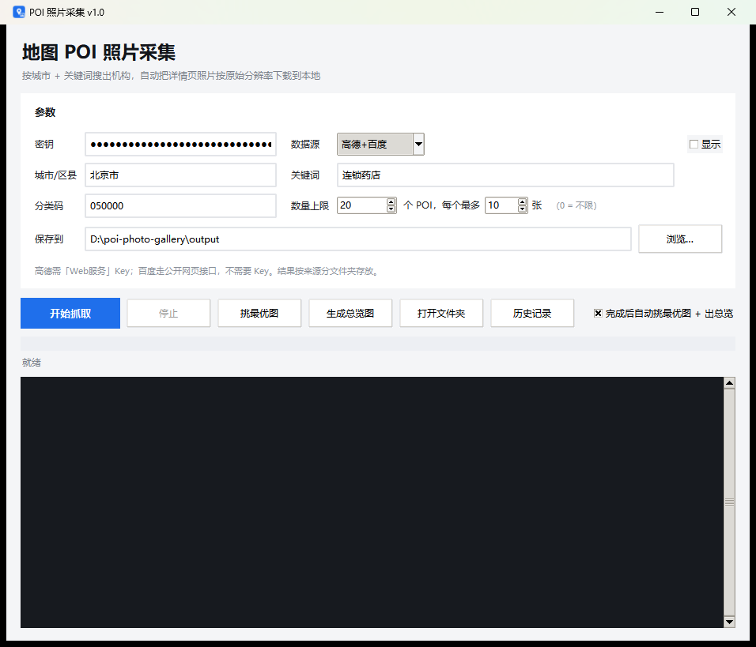

# POI Photo Gallery · 地图 POI 门店照片采集

[](https://www.python.org/)
[](LICENSE)
[](#安装)
[](requirements.txt)

按 **城市 + 关键词** 批量采集高德 / 百度地图上的 POI 门店实景照片，**尽量取到原始分辨率的原图**，按机构分文件夹落盘，附清单与总览大图。

用途举例：给调研报告配门店实景图、核对连锁门店的门头与招牌、批量整理某地某行业的门店影像资料。



> 地图 App 里能看到的照片，走接口拿到的往往只是 500px 缩略图。本项目的核心动作就是**把缩略图地址还原成原图地址**——这是它存在的理由，做法见 [docs/技术要点.md](docs/技术要点.md)。

## 目录

- [特性](#特性)
- [安装](#安装)
- [快速开始](#快速开始)
- [输出结构](#输出结构)
- [附带的独立脚本](#附带的独立脚本)
- [健康探针](#健康探针)
- [高德 Key](#高德-key)
- [使用边界](#使用边界)
- [文档](#文档)
- [打包成 exe](#打包成-exe)

## 特性

- **双数据源**：高德（官方 Web 服务 API）+ 百度（网页接口，免申请 Key），可分别存放、交叉比对
- **原图优先**：高德 CDN 补 `limit_1`、百度相册去掉 `x-bce-process` 缩放参数，并实测校验真实像素
- **按 POI 建目录**：`001_协和医院__B000A843P7/01.jpg、02.jpg…`，文件名、地址、坐标全部进清单
- **manifest.csv**：每个机构一行，含名称 / POI ID / 分类 / 地址 / 电话 / 经纬度 / 照片数 / 已下载 / 最大尺寸 / 抓取日期
- **挑图不只看像素**：同像素档内优先横构图与相册靠前的图——门头照多是这样，菜品特写、菜单、顾客照不是
- **总览图每店三张**：一张挑错整格就作废，并排三张时同格内就有备选；POI 多时自动分页
- **静默失效会喊人**：抓完打印中位分辨率，低于 800px 直接提示「原图参数可能已失效」——这条最要命，因为接口照样返回 200
- **两种入口**：`gui.py`（tkinter 桌面界面）/ `cli.py`（命令行，可脚本化、可 CI）
- **单文件打包**：PyInstaller spec 已备好，可产出免安装 exe
- **仅依赖标准库**：采集全程只用 Python 标准库；Pillow 只在「挑最优 / 总览图」时需要

## 安装

```bash
git clone https://github.com/Remo-019/poi-photo-gallery.git
cd poi-photo-gallery
python -m pip install -r requirements.txt   # 只装 Pillow，用于挑最优图和总览图
```

Python 3.10+（代码用了 `str | None` 之类的新语法）。tkinter 随官方 Python 安装包自带；Linux 上若无声界面需求可只装 `python3-tk` 之外的依赖，纯 CLI 用法不需要 tkinter。

## 快速开始

### 命令行

```bash
# 高德 + 百度双源，每个 POI 最多 10 张图
python cli.py --city 北京市 --keywords 医院 --amap-key <你的高德Key>

# 只跑百度，不需要 Key
python cli.py --city 上海市 --keywords 咖啡馆 --source baidu

# 只列清单，不下载（先看能抓到什么）
python cli.py --city 成都市 --keywords 连锁药店 --source amap --dry-run

# 不限 POI 数量，每个 POI 全部图
python cli.py --city 广州市 --keywords 三甲医院 --max-poi 0 --photos 0
```

Key 也可以放环境变量，避免进 shell 历史：

```bash
export AMAP_KEY=xxxxxxxx        # Windows: setx AMAP_KEY xxxxxxxx
python cli.py --city 北京市 --keywords 医院
```

完整参数：

```bash
python cli.py --help
```

| 参数 | 说明 |
|---|---|
| `--city` | 城市名，必填 |
| `--keywords` | 关键词，必填 |
| `--source` | `both`（默认）/ `amap` / `baidu` |
| `--max-poi` | POI 数量上限，`0` 为不限 |
| `--photos` | 每个 POI 的图片数上限，`0` 为不限 |
| `--out` | 输出根目录，默认 `./output` |
| `--amap-key` | 高德 Key，缺省读环境变量 `AMAP_KEY` |
| `--types` | 高德分类码，默认 `090000`（医疗保健服务） |
| `--delay` | 每次请求间隔秒数，默认 `0.3` |
| `--no-best` | 跳过挑最优图与总览图 |
| `--dry-run` | 只检索并打印清单，不下载 |

### 桌面界面

```bash
python gui.py
```

界面里填城市、关键词、每个 POI 图片数，选数据源（高德+百度 / 高德 / 百度），点「开始抓取」。抓完自动挑最优图并生成总览。参数与 Key 会存到用户配置目录，下次自动带出。

配置位置（Key 明文存放，自己注意别提交）：

- Windows：`%LOCALAPPDATA%\POIPhotoGallery\config.json`
- macOS / Linux：`~/.config/POIPhotoGallery/config.json`

## 输出结构

```
out/20261120_170529_北京市_医院/
├── 高德/
│   ├── 001_协和医院__B000A843P7/   01.jpg  02.jpg  …
│   ├── manifest.csv                名称 / 地址 / 分类 / 经纬度 / 尺寸 / 抓取日期
│   ├── photo_inventory.csv         逐张分辨率盘点
│   ├── best/                       每机构一张最优图
│   ├── contact_sheet.jpg           总览图（POI 少于此一页时）
│   └── contact_sheet_p01.jpg …     总览图分页（每店 3 张，每页 24 个 POI）
└── 百度/                           结构同上，另含电话字段
```

`manifest.csv` 里的「抓取日期」是**抓取当天**的时间，不是照片的拍摄日期——接口不提供拍摄时间，这一点必须记住：照片反映的是抓取当日库内的状态，门店换招牌或搬迁后不会自动更新。

## 附带的独立脚本

`tools/` 下三个脚本不依赖 `poi_core`，可以单独拷走用：

| 脚本 | 作用 |
|---|---|
| `tools/baidu_poi.py` | 只跑百度、单文件版（免 Key），适合快速验证某地某关键词能抓到什么 |
| `tools/select_best.py` | 按已有 `manifest.csv` 为每个机构挑最优图并盘点分辨率（`_report.csv` 会写明入选理由） |
| `tools/make_contact_sheet.py` | 把某目录下的图拼成总览图，可指定每店几张、每页几个 POI |

```bash
# 百度单源（--city-code 是百度城市码，按官方 citycode 表查）
python tools/baidu_poi.py --keyword 医院 --city-code 132 --max-poi 10 --out ./baidu_poi
python tools/select_best.py ./out/20261120_170529_北京市_医院/高德
# 每店 3 张、每页 24 个 POI 的总览图
python tools/make_contact_sheet.py ./out/20261120_170529_北京市_医院/高德 --per-poi 3 --per-page 24
# 只拼 best/ 里挑好的单张
python tools/make_contact_sheet.py ./out/20261120_170529_北京市_医院/高德/best --flat
```

## 健康探针

整个项目的价值建立在高德 CDN 的 `limit_1` 参数上。哪天它被静默忽略，接口照常返回成功、退出码仍是 0，只是图片全变成 500px 缩略图——**崩溃会被人发现，静默失效会进报告**。

`probe.py` 就是为这条准备的：一次搜索 + 几张图，判断「还能不能拿到原图」。

```bash
set AMAP_KEY=你的key                      # macOS/Linux: export AMAP_KEY=...
python probe.py                           # 默认抽查 3 个 POI、中位宽度低于 1200 即报警
python probe.py --json probe_history.json  # 追加一行历史，便于看趋势
```

退出码：`0` 正常 / `1` 中位宽度低于阈值 / `2` 参数缺失或调用失败。放进定时任务，连续两天非 0 就该去核对接口了。

| 参数 | 说明 |
|---|---|
| `--city` / `--keywords` / `--types` | 抽查用的城市、关键词、分类码，默认 北京市 / 医院 / 090000 |
| `--poi` / `--photos` | 抽查几个 POI、每个取几张，默认 3 / 3 |
| `--min-width` | 中位宽度阈值，默认 1200 |
| `--json` | 结果追加到指定 JSON 文件 |
| `--keep` | 保留下载的图片，便于人工核对 |

## 高德 Key

到[高德开放平台](https://lbs.amap.com/)注册 → 控制台 → 应用管理 → 创建应用 → 添加 Key，**服务平台选「Web 服务」**。

个人开发者认证后的免费配额（实测，仅作参考，以官方页面为准）：基础搜索 5000 次 / 月、基础 LBS 15 万次 / 月、基础地图定位 150 万次 / 月。抓 40 个 POI 大约只消耗 2 次搜索配额，图片下载不计入配额。

百度侧无需 Key。

## 使用边界

- 采集频率请自行控制（`--delay` 默认 0.3 秒），别把对方接口当自家数据库刷。
- 抓到的照片版权归原作者与平台，**是否可再发布由你自行判断并承担**；公开发布前建议核对授权。
- 仅用于合法的资料整理与内部研究用途，遵守目标网站的服务条款与当地法律法规。

## 文档

- [docs/技术要点.md](docs/技术要点.md) —— CDN 缩放参数、真原图判定、两源接口差异、踩过的坑
- [CONTRIBUTING.md](CONTRIBUTING.md) —— 提 issue / PR 的约定
- [CHANGELOG.md](CHANGELOG.md) —— 版本变更

## 打包成 exe

```bash
python -m pip install -r requirements-dev.txt
pyinstaller build.spec
# 产物：dist/POIPhotoGallery.exe（单文件，免安装）
```

## 许可证

[MIT](LICENSE)
